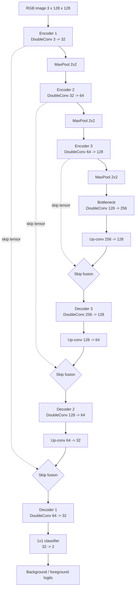

# Semantic Segmentation of Oxford-IIIT Pet Images

## Project report

**Student:** Arshil Yusuf  
**Roll number:** 23115015  
**Programme:** CSE, 7th Semester  

---

## 1. Introduction

Semantic segmentation assigns a class label to every image pixel. For pet images, accurate
foreground segmentation is useful for background removal, image editing, object measurement,
and downstream recognition systems. This project implements a U-Net-style encoder-decoder
network for binary pet segmentation and measures how much the encoder-to-decoder skip
connections contribute to performance.

The study compares:

1. **Baseline U-Net:** decoder blocks receive the learned encoder feature maps through skip
   connections.
2. **Zeroed-skip-fusion ablation:** the same encoder, decoder blocks, concatenation widths,
   and trainable parameters are retained, but each encoder feature used for skip fusion is
   replaced by a zero tensor of identical shape.

This design isolates the information supplied by skip connections without changing model
capacity or parameter count.

## 2. Background study

### 2.1 U-Net

U-Net uses a contracting encoder to capture semantic context and an expanding decoder to
recover spatial resolution. Skip connections concatenate high-resolution encoder features
with decoder features. They preserve boundaries and local details that may be lost during
downsampling.

### 2.2 Skip-connection ablation

A fair ablation should change only the factor under investigation. Removing decoder layers or
changing convolution widths would also change parameter count and capacity. This project
therefore keeps the complete computational graph unchanged and zeros only the tensors
provided by skip fusion.

### 2.3 Dataset

The Oxford-IIIT Pet Dataset contains 37 cat and dog categories with pixel-level trimap
annotations. The original annotation values are:

| Original value | Meaning |
|---:|---|
| 1 | Foreground |
| 2 | Background |
| 3 | Not classified/boundary |

This project remaps the masks to binary segmentation labels:

| Training value | Meaning |
|---:|---|
| 0 | Background |
| 1 | Foreground |
| 255 | Ignore/boundary |

The dataset README states that the dataset is provided for research purposes and that images
retain the terms of use of their original source websites.

## 3. Methodology

### 3.1 Dataset split

The official `trainval.txt` IDs are shuffled using `random.Random(20261114)`. The first 90%
are used for training and the remaining 10% for validation. The official `test.txt` IDs are
used only during final evaluation.

| Split | Images |
|---|---:|
| Training | 3,312 |
| Validation | 368 |
| Test | 3,669 |
| Official split total | 7,349 |
| Images present in the image directory | 7,390 |

The exact IDs are saved in
[`outputs/splits/dataset_splits.json`](outputs/splits/dataset_splits.json).

### 3.2 Preprocessing and augmentation

- Images are converted to RGB.
- Images are resized to 128 x 128 using bilinear interpolation.
- Pixel values are scaled to [0, 1] and normalized with ImageNet mean and standard deviation.
- Masks are resized to 128 x 128 using nearest-neighbor interpolation.
- Nearest-neighbor interpolation prevents fractional or invalid class labels.
- Training images receive a random horizontal flip with probability 0.5.
- Validation and test images receive no random augmentation.
- Original boundary pixels are mapped to ignore value 255.

### 3.3 Ignore-label policy

The ignore value 255:

- Is excluded from `CrossEntropyLoss` through `ignore_index=255`.
- Is excluded from confusion matrices.
- Is excluded from IoU and Dice calculations.
- Is not treated as a third segmentation class.

The measured ignored-pixel percentage is **11.5782%** over the paired dataset masks.

### 3.4 Model architecture

Both experiments use exactly the same architecture:

Standalone diagram: [`docs/architecture.svg`](docs/architecture.svg).



In the baseline, each skip tensor is passed unchanged. In the ablation, the tensor entering
each dashed skip path is replaced with `torch.zeros_like(tensor)`. Concatenation dimensions
remain 256, 128, and 64 respectively.

### 3.5 Training configuration

| Setting | Value |
|---|---|
| Optimizer | AdamW |
| Learning rate | 0.001 |
| Weight decay | 0.0001 |
| Maximum epochs | 20 |
| Early-stopping patience | 4 epochs |
| Batch size | 32 |
| Input size | 128 x 128 |
| Loss | Cross-entropy with ignore index 255 |
| Random seed | 20261114 |
| Hardware | NVIDIA GeForce GTX 1650 |
| Trainable parameters | 1,927,042 for both models |

## 4. Results and interpretation

### 4.1 Training and comparison budget

| Model | Max epochs | Actual epochs | Optimizer updates | Best validation epoch | Training time (s) | Parameters |
|---|---:|---:|---:|---:|---:|---:|
| Baseline | 20 | 14 | 1,456 | 10 | 609.738 | 1,927,042 |
| Zeroed-skip fusion | 20 | 8 | 832 | 4 | 436.426 | 1,927,042 |

The zeroed-skip model trained **173.312 seconds less** because early stopping terminated it
earlier. Both models used the same maximum budget and optimization configuration.

### 4.2 Test metrics

All metrics below are computed only over valid, non-ignored pixels.

| Model | Background IoU | Foreground IoU | mIoU | Dice |
|---|---:|---:|---:|---:|
| Baseline | 0.9179 | 0.8470 | **0.8825** | **0.9372** |
| Zeroed-skip fusion | 0.8945 | 0.8107 | **0.8526** | **0.9199** |

The baseline improves mIoU by **0.0299** and Dice by **0.0173** over the zeroed-skip
ablation. This supports the conclusion that skip features provide useful spatial information
for both foreground boundaries and background classification.

### 4.3 Confusion matrices

Rows are ground-truth classes and columns are predicted classes. Class order is
`[background, foreground]`.

**Baseline**

| | Predicted background | Predicted foreground |
|---|---:|---:|
| Actual background | 33,280,556 | 1,418,328 |
| Actual foreground | 1,557,392 | 16,471,173 |

**Zeroed-skip fusion**

| | Predicted background | Predicted foreground |
|---|---:|---:|
| Actual background | 32,479,577 | 2,219,307 |
| Actual foreground | 1,613,331 | 16,415,234 |

The ablation produces more background-to-foreground errors, which is consistent with losing
high-resolution encoder information during decoder reconstruction.

### 4.4 Inference benchmark

| Model | Test inference duration (s) | Hardware |
|---|---:|---|
| Baseline | 75.336 | NVIDIA GeForce GTX 1650 |
| Zeroed-skip fusion | 40.487 | NVIDIA GeForce GTX 1650 |

The benchmark duration is the measured end-to-end test-loader inference duration recorded by
the evaluation script. It is not a per-image latency measurement.

## 5. Reproducibility audit

- Both models use the same exact dataset IDs.
- Both models use identical preprocessing and augmentation implementations.
- Both models use identical optimization settings and random seed.
- Both models use the same evaluation function.
- Test images are not loaded by the training loop.
- Checkpoints store model name, configuration, seed, best epoch, and parameter count.
- Ignore value 255 is excluded from loss and all reported metrics.
- The two models have exactly equal trainable parameter counts.
- Every reported metric is regenerated by:

```powershell
python experiment.py evaluate --checkpoint outputs\checkpoints\baseline_best.pt
python experiment.py evaluate --checkpoint outputs\checkpoints\zeroed_skip_best.pt
```

The complete audit is saved at
[`outputs/results/REPRODUCIBILITY_AUDIT.md`](outputs/results/REPRODUCIBILITY_AUDIT.md).

## 6. Conclusion

The controlled experiment demonstrates that encoder skip information materially improves
binary pet segmentation. The baseline achieved an mIoU of 0.8825 and Dice of 0.9372,
compared with 0.8526 mIoU and 0.9199 Dice when skip tensors were zeroed. Since the models
have the same architecture and 1,927,042 trainable parameters, the observed difference is
attributable to the information carried by skip connections rather than extra capacity.

The experiment also provides a reproducible data contract, explicit compute budget, exact
split manifest, ignore-label validation, checkpoint metadata, and machine-readable results.

## References

1. O. M. Parkhi, A. Vedaldi, A. Zisserman, and C. V. Jawahar, “Cats and Dogs,”
   *IEEE Conference on Computer Vision and Pattern Recognition (CVPR)*, 2012.
2. O. Ronneberger, P. Fischer, and T. Brox, “U-Net: Convolutional Networks for Biomedical
   Image Segmentation,” *MICCAI*, 2015.
3. Oxford-IIIT Pet Dataset documentation, `data/annotations/README`.
